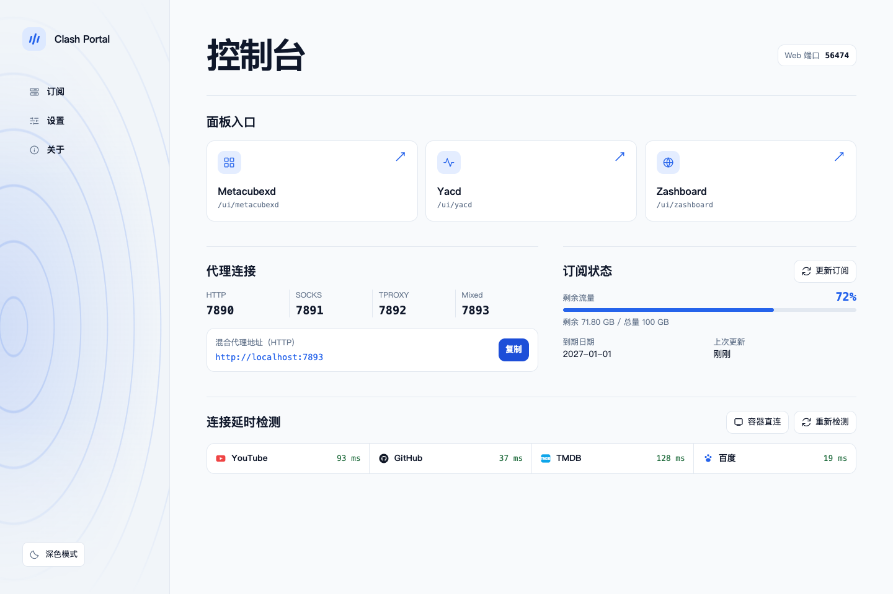
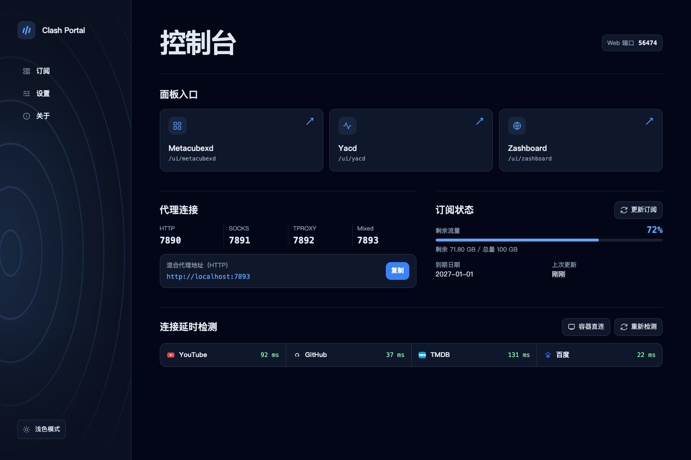
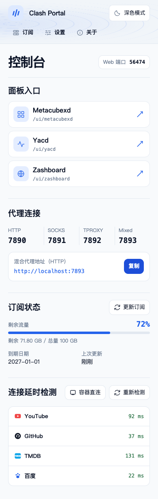
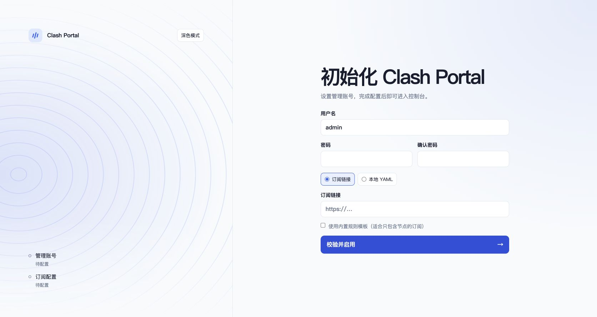
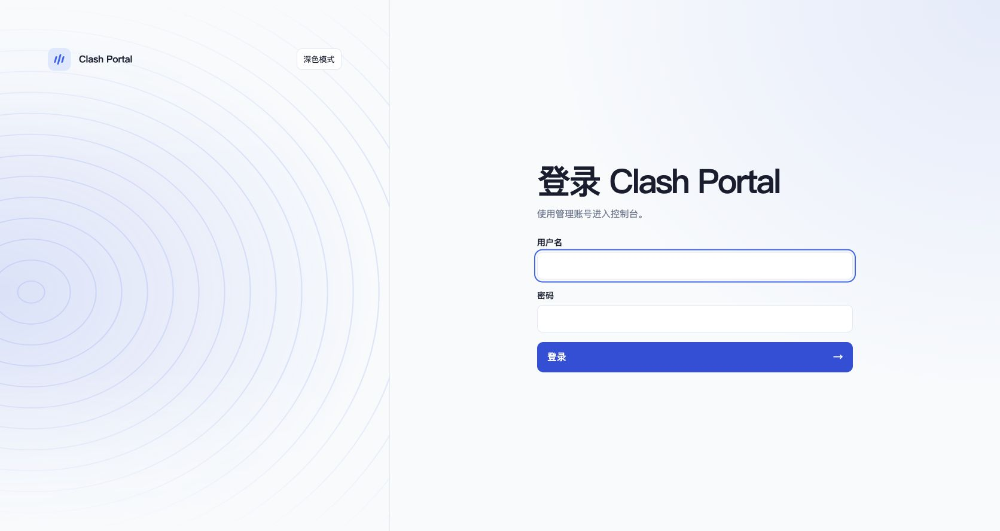
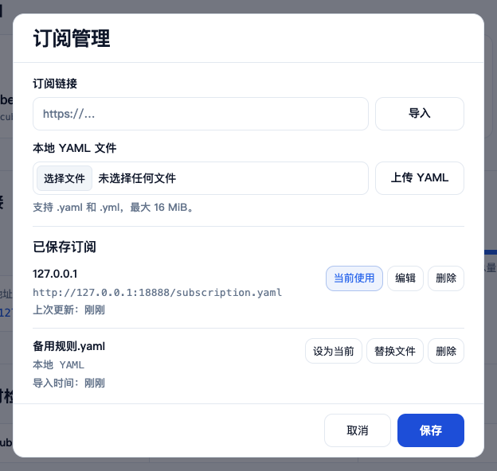
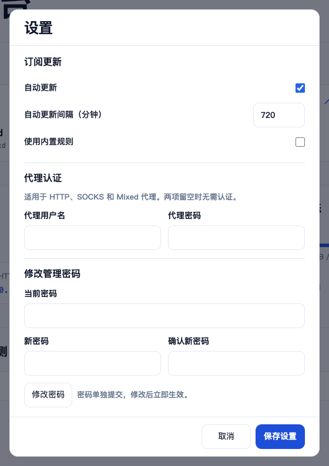
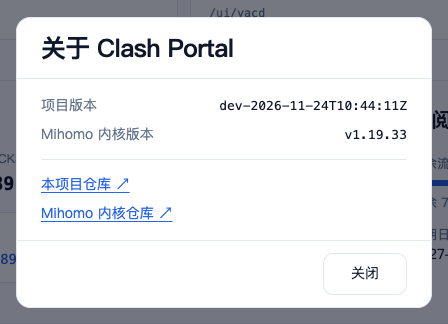

# Clash Meta Docker

用 Docker Compose 部署 Mihomo（Clash Meta），然后在 **Clash Portal** 里导入订阅、管理配置、查看连接状态。控制台内置 Metacubexd、Yacd 和 Zashboard，使用同一个 Web 入口打开。

[快速开始](#快速开始) · [日常操作](#日常操作) · [端口与远程访问](#端口与远程访问) · [常见问题](#常见问题) · [更新日志](CHANGELOG.md)



*截图使用测试实例。默认 Web 端口是 `9090`，订阅余量和延时以实际运行结果为准。*

<details>
<summary>查看深色模式和手机布局</summary>





</details>

## 快速开始

准备好 **Docker 和 Docker Compose**，以及一份 Clash YAML 订阅链接或本地文件。项目发布的镜像支持 `linux/amd64` 和 `linux/arm64`。

### 1. 启动容器

```bash
git clone https://github.com/bctjo/docker-clash.git
cd docker-clash
docker compose up -d
```

[默认 Compose 文件](docker-compose.yml)使用 `ghcr.nju.edu.cn/bctjo/docker-clash:latest`，并把运行数据保存到项目根目录下的 `./data` 目录。

### 2. 打开 Portal 并完成初始化

在部署主机上打开 <http://localhost:9090>。从其他设备访问时，把 `localhost` 换成部署主机的地址。

设置管理用户名和密码，选择 **订阅链接** 或 **本地 YAML**，然后点击 **校验并启用**。配置通过校验且 Mihomo 启动后，Portal 会自动进入控制台。



默认使用订阅自带的规则和分组，请导入含 `rules` 的完整 Clash YAML，或使用 `mode: global` 的配置。如果 YAML 只有节点列表，勾选 **使用内置规则模板**。节点 URI 或 Base64 订阅需要先转换为 Clash YAML。

### 3. 打开面板或连接代理

在 **面板入口** 点击 Metacubexd、Yacd 或 Zashboard，即可使用当前 Portal 地址连接内核。需要为客户端配置代理时，可以在 **代理连接** 复制 Mixed 端口的 HTTP 地址。

<details>
<summary>查看登录页</summary>

下次需要登录时，使用初始化时设置的管理账号。



</details>

## 日常操作

| 想做什么 | 在哪里操作 |
| --- | --- |
| 导入、切换或替换订阅 | 打开 **订阅**，导入链接或上传 YAML。点击 **设为当前** 后保存以切换。 |
| 更新当前链接订阅 | 在控制台的 **订阅状态** 点击 **更新订阅**。自动更新及其间隔在 **设置 → 订阅更新** 配置。 |
| 给代理连接加认证 | 在 **设置 → 代理认证** 填写用户名和密码，再点击 **保存设置**。 |
| 修改管理密码 | 在 **设置 → 修改管理密码** 填写当前密码和新密码，点击 **修改密码** 单独提交。 |
| 查看项目和内核版本 | 打开 **关于**。 |
| 检查连接延时 | 在 **连接延时检测** 切换 **容器直连** 或 **代理规则**，然后重新检测。 |

<details>
<summary>查看订阅管理、设置和关于截图</summary>







</details>

本地文件支持 UTF-8 编码的 `.yaml` / `.yml`，最大 16 MiB，保存在 `data/local-subscriptions/`。定时更新只下载链接订阅。本地配置通过订阅列表里的 **替换文件** 更新，订阅列表会显示导入时间。流量只有在链接订阅提供相关数据时才显示。

订阅更新会先下载并校验新配置，再尝试热加载。应用失败时保留原有可用配置和订阅选择。镜像在构建时已预置 geodata，容器也支持在后台更新这些文件。

## 端口与远程访问

| 默认端口 | 用途 |
| --- | --- |
| `9090` | Portal、三个 Web 面板和经 Portal 转发的 Clash API |
| `7890` | HTTP 代理 |
| `7891` | SOCKS5 代理 |
| `7892` | TPROXY 端口 |
| `7893` | Mixed 代理 |
| `9097` | 容器内 Mihomo API，默认仅监听容器回环地址，Compose 未映射 |

远程管理时，将 HTTPS 反向代理或穿透服务指向部署主机的 `9090`，并开启 WebSocket 转发。内置面板使用当前访问的域名、协议和端口连接 API，连接与日志的 WebSocket 也走同一个入口。

如需直接连接内核 API，在项目根目录的 `.env` 设置 `DASH_BIND_ADDRESS=0.0.0.0`，取消 Compose 中 `127.0.0.1:9097:9097` 的注释，再重新运行 `docker compose up -d`。直连时使用 API 密钥认证。容器内部的 `PORTAL_PORT` 和 `DASH_PORT` 须使用不同的端口。

## 配置与数据

| 配置项 | 用途与默认值 |
| --- | --- |
| `PORTAL_ADMIN_USERNAME` / `PORTAL_ADMIN_KEY` | 可选的预设管理账号。预设密码但未指定用户名时使用 `admin`。 |
| `SUBSCR_URLS` | 可选的首次启动订阅链接，多个地址以逗号分隔。已有保存的订阅优先。 |
| `CLASH_SECRET` | 可选的 Clash API 密钥，默认由容器生成并持久化。 |
| `DASH_BIND_ADDRESS` | Mihomo API 监听地址，默认 `127.0.0.1`。 |
| `UPDATE_INTERVAL` | 容器默认自动更新间隔，`43200` 秒（12 小时）。 |
| `SUBSCR_CONNECT_TIMEOUT` | 下载订阅的连接超时，默认 15 秒。 |
| `SUBSCR_VALIDATE_MAX_TIME` / `SUBSCR_DOWNLOAD_MAX_TIME` | 导入校验和更新下载的单次下载超时，默认各 120 秒。 |
| `CONFIG_VALIDATE_MAX_TIME` / `SUBSCR_MAX_BYTES` | 配置校验超时和链接订阅下载上限，默认 90 秒和 16 MiB。 |

预设账号、订阅和 API 密钥可参考 [.env.example](.env.example)。容器运行参数需要通过 Compose 的 `environment` 传入，映射及示例见 [docker-compose.yml](docker-compose.yml)。

**三种凭据分别管理。** Portal 管理账号用于登录和管理订阅，密码以加盐哈希保存。Clash API 密钥用于内核 API，默认保存在 `data/portal.json`。代理认证用于 HTTP、SOCKS5 和 Mixed 代理，启用时须填写两项，两项都留空并保存即可关闭。TPROXY 不使用这组凭据。通过 Portal 保存的代理认证优先于订阅原有的代理认证设置。

管理账号、订阅、配置、geodata 和运行状态都在 **`data/`** 下。备份或迁移时保留整个目录。

<details>
<summary>通过环境变量重置密码或轮换 API 密钥</summary>

在项目根目录的 `.env` 中设置新的 `PORTAL_ADMIN_KEY`，再执行 `docker compose up -d`，可重置管理密码。

轮换 Clash API 密钥时，设置新的 `CLASH_SECRET`（可用 `openssl rand -hex 24` 生成），再执行 `docker compose up -d --force-recreate`。从 Portal 重新打开面板即可使用当前密钥。

</details>

## 升级

备份 `data/` 后，在当前部署目录更新 Compose 使用的镜像。

```bash
docker compose pull
docker compose up -d
```

旧版自设的管理密码会继续生效，用户名为 `admin`。曾经免登录或使用自动生成密码的实例，升级后需要在初始化页设置自己的管理账号。可用的订阅会沿用。旧版 `PORTAL_AUTH_ENABLED=false` 已失效。免登录实例升级时，自动管理的 API 密钥会更新一次，显式设置的 `CLASH_SECRET` 会保留。

<details>
<summary>旧订阅的客户端指纹兼容</summary>

生成运行配置时，旧版 `global-client-fingerprint` 会迁移到支持该选项的节点，保留节点显式设置（包括 `none`）。完整配置和内置模板均支持。HTTP、file 和 inline 类型的 `proxy-providers` 通过 `override-expr` 补齐缺少的指纹，已有覆写表达式优先。原始订阅缓存保持原样。自定义旧内核时请确认它支持 `override-expr`，项目固定版本见 [core/mihomo-version.txt](core/mihomo-version.txt)。

启用内置模板时，**🚀 默认代理**优先选择 **⚡ 自动选择**（全部节点自动测速），其次是香港等地区分组。已有的模板设置和手动选择会保留。

</details>

## 常见问题

- **打不开 Portal。** 在部署目录执行 `docker compose ps` 和 `docker compose logs --tail=100 clash`，确认容器状态和主机端口映射。从其他设备访问时使用部署主机的地址。
- **初始化提示配置校验失败。** 检查链接能否从部署环境下载，以及内容是否为 Clash YAML。只有节点列表时启用内置规则模板。上传文件时检查扩展名、编码和大小。
- **面板能打开，但连接或日志不刷新。** 从 Portal 重新打开面板，使用反向代理或穿透服务时检查 WebSocket 转发。
- **检测到的延时与本机不同。** 容器直连和代理规则检测都在容器内执行，后者经 Mixed 端口按当前规则发起请求。

## 构建与维护

从源码构建时，Docker 会按 [core/mihomo-version.txt](core/mihomo-version.txt) 下载 Mihomo。构建后将 Compose 的 `image` 改成自建镜像标签即可部署。

```bash
docker build -t clash-meta:local .
```

<details>
<summary>查看本地验证与发布流程</summary>

```bash
docker build -t clash-meta-review:local .
docker run --rm --entrypoint python3 -v "$PWD:/src:ro" -w /src clash-meta-review:local -m unittest discover -s tests -p 'test_*.py' -v
python3 tests/integration.py
python3 tests/auth_integration.py
node tests/check_frontend.cjs
```

隔离容器测试使用临时数据和本地订阅服务。可选浏览器测试需要 Playwright 和 Chromium，通过 `RUN_BROWSER_TESTS=1 python3 tests/integration.py` 启用。本机运行指纹测试时可用 `MIHOMO_BIN` 指定 Mihomo 二进制路径。

构建时可用 `--build-arg MIHOMO_VERSION=<版本>` 覆盖固定内核版本，或用 `--build-arg APT_MIRROR=mirrors.ustc.edu.cn` 更换 Debian 软件源。

[Runtime checks](.github/workflows/checks.yml) 验证配置、更新、回滚和重启。[自动发布流程](.github/workflows/auto-release-mihomo.yml) 每 6 小时检查 Mihomo 更新，镜像构建和发布成功后推送版本提交与标签。[标签发布流程](.github/workflows/release-ghcr.yml) 发布多架构镜像及正式 Release。仅推送 `main` 会触发检查。版本变更见 [CHANGELOG.md](CHANGELOG.md)。

提交说明按类型使用 `🐞 fix`、`✨ feat`、`🚀 ci(release)`、`🔧 chore(core)`、`📝 docs` 或 `✅ test`，每条说明写清具体变化。

</details>
